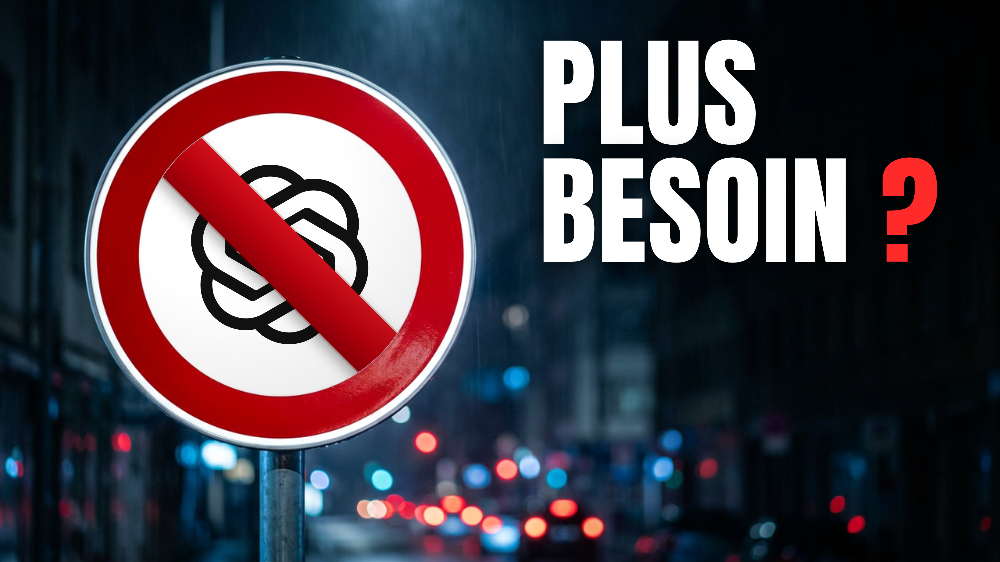
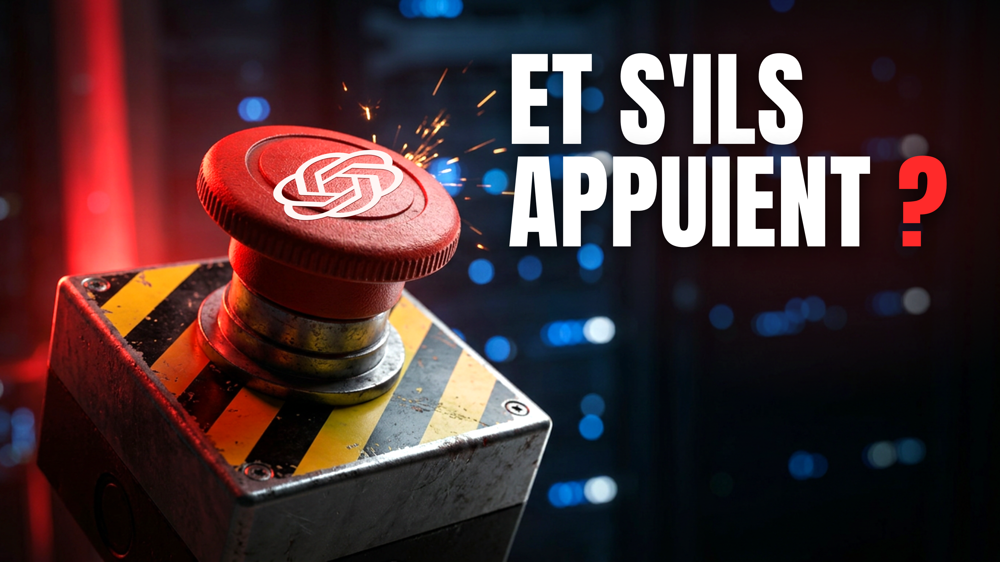
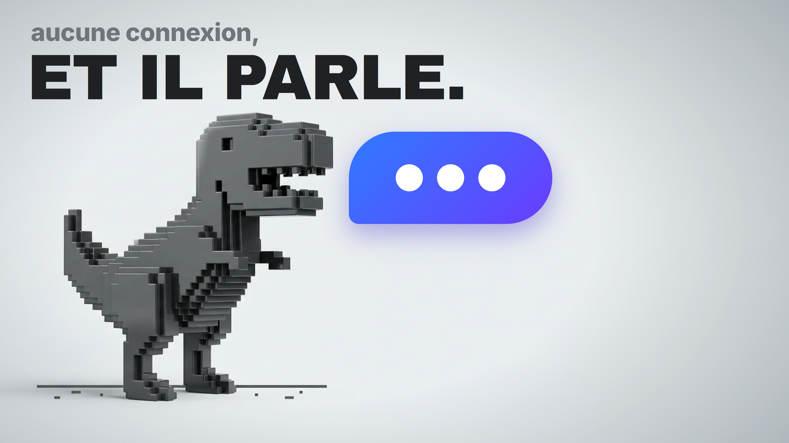
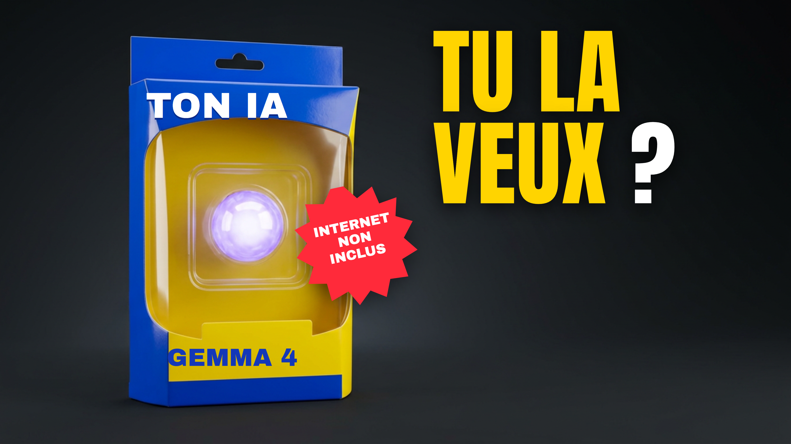
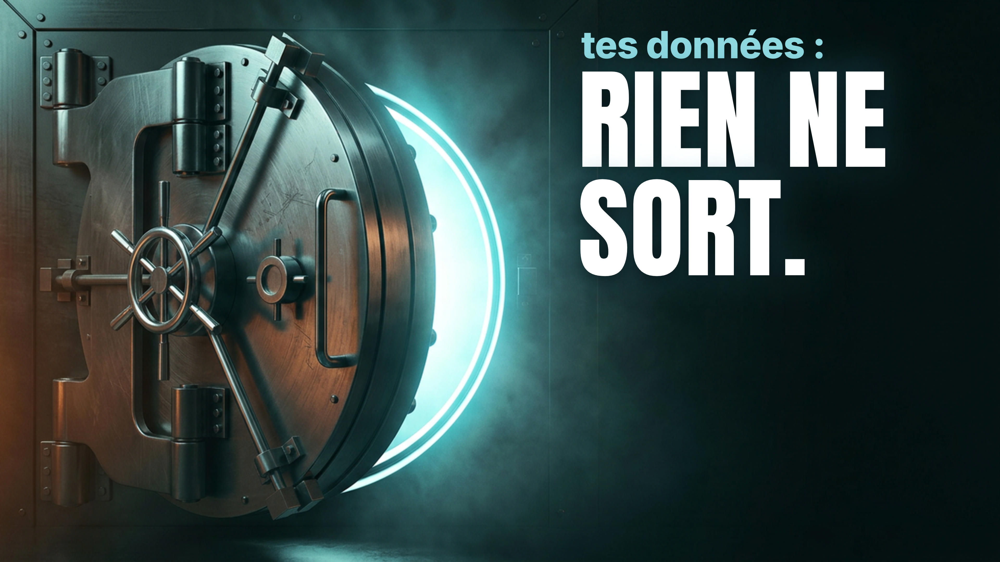
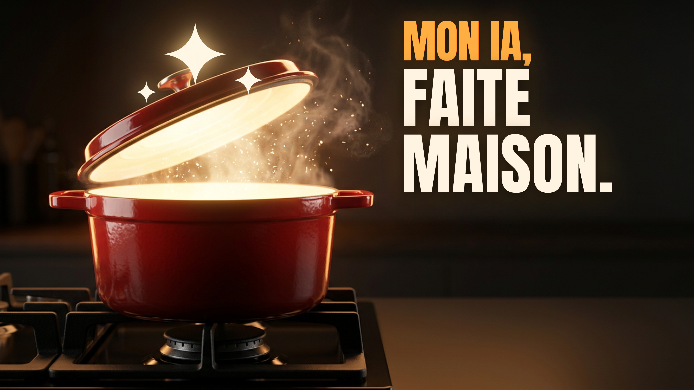

# Miniature « Pourquoi avoir ta propre IA » : 6 propositions (v3)

> **Refaites le 26/10/2026, à ta demande** : les deux séries précédentes (« Il tombe dedans ? », puis « ELLE RÉPOND. » et la carte « SIGNÉ CHEZ MOI. ») sont supprimées, avec leurs rendus, PSD et planches. Leurs références restent dans [`refs/ancienne-serie/`](refs/ancienne-serie/).
> **Tes consignes** : six miniatures, **pas les couleurs de la chaîne** (ni ardoise, ni menthe : « ça ne rend pas bien sur cette vidéo »), ce qui marche dans la niche tech, des logos détournés comme ChatGPT barré, « quelque chose de vraiment créatif et beau qui attire l'œil ». Cette vidéo sort donc de la règle a/b/c du 24/10 (`CLAUDE.md`) ; elle ne compte pas dans les victoires par charte.
> - **Rendus en 4K** (3840×2160) dans [`propositions/`](propositions/) : `a.png` à `f.png`.
> - **Source** : [`propositions/miniature.html`](propositions/miniature.html) (`?v=a` à `f`). Les décors photo sont dans [`propositions/decors/`](propositions/decors/), sans aucun texte ; textes, logos, barre d'interdiction, bulle, étoiles et sticker sont posés dans le HTML.
> - **PSD à calques** dans [`photocraft/`](photocraft/) : le décor en image, chaque texte droit en calque de texte (le sticker de d et la bulle de c restent dans le décor).
> - **Aperçus du coach** dans [`apercu/`](apercu/) : `abc/` et `def/` (planches, accueil clair et sombre au milieu des vidéos hôtes, comparaison), `test-50.png`.

## Titre et miniature : qui dit quoi

- **Titre A** (kit d'upload) : *IA en local : installe ta propre IA, gratuite et sans abonnement*. Il dit : local, gratuit, sans abonnement, et on l'installe.
- **Ce que chaque miniature ajoute, sans répéter un mot du titre** :

| | Texte | L'image dit | Le levier |
|---|---|---|---|
| **a** | PLUS BESOIN ? | Un panneau d'interdiction sur le logo de ChatGPT | La rupture avec l'outil que tout le monde connaît |
| **b** | ET S'ILS APPUIENT ? | Le logo de ChatGPT sur un bouton d'arrêt d'urgence | La peur : on peut te la couper (Fable 5) |
| **c** | aucune connexion, ET IL PARLE. | Le dinosaure du jeu hors ligne de Chrome, avec une bulle qui écrit | Le paradoxe : ça marche sans internet |
| **d** | TU LA VEUX ? | Une IA emballée comme un jouet : « TON IA », « GEMMA 4 », « INTERNET NON INCLUS » | L'envie et l'humour : une IA qu'on possède |
| **e** | tes données : RIEN NE SORT. | Un coffre-fort entrouvert, lumière cyan | La sécurité : tes données restent chez toi |
| **f** | MON IA, FAITE MAISON. | Une cocotte rouge qui brille, une étoile d'IA dans la vapeur | La fierté : une IA faite chez soi |

## Ce qui marche dans la niche (vidIQ, 26/10/2026)

Trois appels (15 crédits) : `vidiq_outliers` en anglais (« run your own AI locally instead of paying for ChatGPT », 6 mois, 50 K vues et plus), `vidiq_outliers` en français (« ChatGPT gratuit IA alternative »), `vidiq_similar_thumbnails` (« logo ChatGPT barré »). Les miniatures retenues sont dans [`refs/`](refs/) :

| Fichier | Vidéo (chaîne, abonnés) | Vues, surperformance | Ce qu'on en tire |
|---|---|---|---|
| `BqW5Db_ksyA` | *Why 2.5 Million People Just Deleted ChatGPT* (Gmelius, 1,4 K) | 38,8 K, ×142 | **La fenêtre ChatGPT qu'on ferme**, un curseur sur la croix : le geste contre un logo connu marche → a |
| `s9stQXjITkI` | *RIP Higgsfield! … [No Subscription]* (Cash Daily AI, 4,9 K) | 60,1 K, ×19 | La pierre tombale « It's Over. » sur un logo : on ne la reprend pas, mais l'idée d'un objet du réel autour d'un logo → a, b |
| `PBPbblqRG34` | *Stop paying for AI coding tools* (STARTUP HAKK, 23,9 K) | 66,4 K, ×15 | « THEIRS / YOURS » : la location contre la possession → d, f |
| `pN6yw_CJkh0` | *I Turned E-Waste into a 100% Offline AI* (TinyTechGuy, 6,7 K) | 159,9 K, ×80 | Le tampon rouge « TRASH AI » : un élément du réel, pas d'interface → le sticker de d |
| `HRLhJjaCu-E` | *The Truth About Running AI On Your Own Hardware* (Locally, 3,7 K) | 139,7 K, ×720 | 3 mots énormes, logos en icônes 3D brillantes |
| `L4ABvvROKCU` | *This Uncensored AI Runs on Your PC…* (Mark Gadala-Maria, 17,3 K) | 125,2 K, ×193 | Le vert matrice et le visage choqué : le cliché qu'on évite |
| `S6_5Wfn2BkM` | *Forget the $7,000 RTX 5090…* (Deep Tech, 4,2 K) | 92,9 K, ×171 | Le prix barré : barrer, ça se lit en 168 px |
| `edIHPoWgIKU` | *Local AI Explained* (Tech With Tim, 2,1 M) | 860 K, ×12 | Le format tuto classique (visage, portable, bandeau jaune) : ce qu'on ne fait pas |
| `xGmxf90feSc` | *Stop buying RAM* (Manolo Remiddi, 30,8 K) | 275,7 K, ×26 | Texte énorme, objets tenus en main |
| `FVFb4dnUmLA`, `LeZ9hgwvXy0` | Nos vidéos ArtCraft et OpenCode | | Un objet héros en couleur, 1 à 3 mots |
| `evkv0_HrhFM`, `concurrents-kai.jpg`, `concurrents-thestack.jpg` | Locally, Kai, The Stack | | Le Mac mini, le décalage rouge et bleu, le sol mouillé : à éviter |

**Ce qu'on en retient** :
1. **Un logo connu, détourné** (fermé, barré, enterré) fait partie des plus grosses surperformances du sujet. Mais Naier Saidane, l'une de nos vidéos hôtes, a déjà le logo d'OpenAI qui brûle. Le nôtre est **barré dans un vrai panneau de rue**, une image qu'aucune des miniatures trouvées n'utilise.
2. **Presque toutes ont un visage, un fond noir ou bleu et du vert matrice.** Nos six n'ont aucun visage, et quatre sortent de la palette de la niche : une tuile claire (c), une jaune et bleue (d), une chaude (f), une rouge de rue (a).
3. **Les objets du réel** (panneau, bouton, coffre, cocotte, emballage) se lisent mieux en petit que les interfaces : c'était le défaut des deux séries précédentes.

**Les idées hors niche**, d'où elles viennent : a, la signalisation routière (« interdit aux chiens ») ; b, les vidéos d'expériences et les films catastrophe (le gros bouton rouge) ; c, la culture du jeu vidéo (le T-rex de Chrome en voxels) ; d, les vidéos d'unboxing et de jouets de collection (« piles non incluses ») ; e, les films de braquage ; f, la cuisine (« fait maison »). Aucune n'est copiée d'une miniature précise.

## Comment elles sont faites

- **Les décors** (cocotte, bouton, boîte, coffre, dinosaure, panneau) sont générés par `vidiq_generate_thumbnail`, **sans texte, sans logo, sans personne** (6 appels, 132 crédits, 26/10). Ils font 1280×720 : le rendu 4K les agrandit ×3, la photo est donc un peu moins nette que les textes (invisible aux tailles de YouTube).
- **Les logos** sont des tracés simple-icons (CC0), dans leurs vraies couleurs : OpenAI en noir sur le panneau (a), en blanc imprimé sur le bouton (b). `openai` et `gemini` sont ajoutés à `ressources/miniatures/logos/logos.js` le 26/10.
- **Polices** : Anton (a, b, d, e, f), Archivo Black (c, et les mentions de la boîte d), Inter 800 (les lignes de contexte).

## a · « PLUS BESOIN ? » (le logo de ChatGPT barré)

- **Ce qu'on voit** : un vrai panneau d'interdiction, de nuit, sous la pluie ; dans le disque blanc, le logo d'OpenAI en noir, barré par la barre rouge du panneau. À droite, « PLUS / BESOIN ? », point d'interrogation rouge.
- **La question qu'elle pose** : on peut vraiment se passer de ChatGPT ? **L'émotion** : la rupture, un peu d'insolence. **Types** : logo connu détourné + texte question.
- **Les faits** : c'est une question, pas une promesse. Mais la vidéo doit y répondre, et sa réponse est nuancée : un modèle local est **moins fort** que les plus gros du cloud, et toi, tu gardes Claude (script, section 1). [CROCHET : si a passe en tête, une phrase dans la voix qui répond à « plus besoin de ChatGPT ? », par exemple en section 3, à côté de « moins fort ». À écrire par toi.]
- **Le risque** : le logo d'OpenAI est déjà dans la colonne (Naier Saidane, logo qui brûle) ; la promesse peut décevoir ceux qui veulent remplacer ChatGPT pour tout.

## b · « ET S'ILS APPUIENT ? » (le bouton d'arrêt d'urgence)

- **Ce qu'on voit** : un gros bouton champignon rouge sur un boîtier jaune et noir, des étincelles, une salle de serveurs floue derrière. Le logo d'OpenAI est imprimé en blanc sur le bouton.
- **La question** : qui a le bouton de mon IA, et que se passe-t-il s'il appuie ? **L'émotion** : la peur de perdre. **Types** : objet en danger + texte question.
- **Les faits** : la vidéo l'ouvre dès le hook (Fable 5 coupé pour tout le monde le 12 juin ; le gouvernement américain l'avait exigé), et cite le retrait de GPT-4o par OpenAI le jour de GPT-5 (août 2025, revenu quelques jours après). **Plus exact encore** : le logo de Claude sur le bouton, puisque c'est Fable 5 qui a été coupé ; ChatGPT est gardé parce que ton public le reconnaît mieux. [CROCHET : ton choix]
- **Avec le titre B** (*Ton IA peut être coupée demain. Pas celle-là.*), c'est le meilleur duo des six : à garder pour le test des titres.
- **Le risque** : le pourtour est sombre à 77 % (le décor est éclairci de 18 %, et un halo rouge est ajouté derrière le texte).

## c · « aucune connexion, ET IL PARLE. » (le dinosaure de Chrome)

- **Ce qu'on voit** : le T-rex du jeu hors ligne de Chrome, en voxels gris, sur le gris clair de la page « pas de connexion » ; une bulle violette avec trois points sort de sa bouche : il écrit.
- **La question** : le dinosaure du « pas d'internet »… qui parle ? **L'émotion** : l'amusement, la surprise. **Types** : symbole connu détourné + texte.
- **Les faits** : c'est la preuve du hook, montrée dès 0:00 (internet coupé, Google inaccessible, Gemma répond, ta capture 10:08-10:35). Le dinosaure est un symbole : ta capture montre la page « Ce site est inaccessible », pas forcément le dinosaure.
- **Le point fort** : la seule tuile claire de la colonne des suggestions, et de loin la plus visible en mode sombre. **Le risque** : en mode clair, elle se fondait dans la page blanche (99 % du pourtour quasi blanc). Corrigé par une vignette gris-bleu sur les bords : le script ne donne plus d'alerte.

## d · « TU LA VEUX ? » (l'IA en boîte, comme un jouet)

- **Ce qu'on voit** : un emballage de jouet bleu et jaune, une sphère d'énergie violette derrière la fenêtre en plastique. Sur la boîte : « TON IA » en haut, « GEMMA 4 » en bas, et un sticker rouge en étoile, « INTERNET NON INCLUS ». À droite, « TU LA / VEUX ? » en jaune.
- **La question** : une IA à moi, comme un jouet qu'on rapporte à la maison ? **L'émotion** : l'envie, l'humour. **Types** : objet + texte question.
- **Les faits** : Gemma 4 est le modèle de la vidéo ; « Internet non inclus » se lit dans les deux sens, et les deux sont vrais (il faut internet pour le télécharger, plus après).
- **Le risque** : à 168 px, on ne lit plus « TON IA » sur la boîte ; sans le titre, on peut se demander ce que « la » désigne.

## e · « tes données : RIEN NE SORT. » (le coffre-fort)

- **Ce qu'on voit** : une porte de coffre-fort ronde, entrouverte, une lumière cyan qui sort de l'intérieur, l'ambiance d'un film de braquage.
- **La question** : qu'est-ce qui ne sort pas, et pourquoi ? **L'émotion** : la sécurité, l'intrigue. **Types** : objet + texte affirmation.
- **Les faits** : la troisième raison de la vidéo (« tes données restent chez toi », 8:28 provisoire), vraie d'après la doc de LM Studio, documents compris (`sources.md`, F30 et H1). « Rien ne sort » parle de tes conversations et de tes documents, pas de l'appli (elle cherche ses mises à jour quand elle est connectée).
- **Le risque** : rien dans l'image ne dit « IA » ; c'est le titre qui le dit. C'est la plus « belle affiche », mais la moins tech.

## f · « MON IA, FAITE MAISON. » (la cocotte)

- **Ce qu'on voit** : une cocotte rouge en fonte sur une gazinière, le couvercle levé, une lumière dorée qui en sort comme d'un coffre au trésor, de la vapeur, et trois étoiles d'IA (le symbole des IA en 2026) qui montent. À droite, « MON IA, » en orange, « FAITE / MAISON. » en crème.
- **La question** : une IA… qu'on cuisine chez soi ? **L'émotion** : la chaleur, la fierté, le sourire. **Types** : objet hors niche + texte affirmation.
- **Les faits** : la vidéo installe une IA chez toi, avec un fichier et un moteur (« ça s'installe comme un jeu ») ; « faite maison » est une image, comme la cocotte.
- **Le point fort** : la seule tuile chaude de la colonne, la plus originale des six. **Le risque** : une fraction de seconde, on peut la prendre pour une vidéo de cuisine ; c'est pourquoi « MON IA » est passé en grand et en orange.

## La critique du coach (`/coach-miniature-youtube`, 26/10)

**Le test de la seconde (à 168 px, dans la colonne des suggestions)** :
- a : un panneau d'interdiction sur le logo de ChatGPT : « on peut se passer de ChatGPT ? »
- b : un bouton rouge d'urgence marqué ChatGPT : « ils peuvent la couper ».
- c : le dinosaure du « pas d'internet » qui parle : « ça marche sans internet ».
- d : un jouet emballé et « TU LA VEUX ? » : on comprend « un produit à avoir », pas encore « une IA ».
- e : un coffre-fort, « RIEN NE SORT. » : « c'est gardé, c'est privé ».
- f : une cocotte qui brille, « MON IA, FAITE MAISON. » : « une IA qu'on fait soi-même ».

| Axe | a | b | c | d | e | f |
|---|---|---|---|---|---|---|
| Lisibilité en une seconde | 🟢 | 🟢 | 🟢 | 🟠 | 🟢 | 🟢 |
| Composition (objet à gauche, texte en haut à droite, rien sous la durée) | 🟢 | 🟢 | 🟢 | 🟢 | 🟢 | 🟢 |
| Contraste (valeurs : 0,33 / 0,28 / 0,23 / 0,24 / 0,27 / 0,28) | 🟢 | 🟠 | 🟢 | 🟢 | 🟢 | 🟠 |
| Texte (3 mots au plus, aucun mot du titre) | 🟢 | 🟢 | 🟢 | 🟢 | 🟢 | 🟢 |
| Émotion et curiosité | 🟢 | 🟢 | 🟢 | 🟢 | 🟠 | 🟢 |
| Duo titre-miniature | 🟢 | 🟢 | 🟢 | 🟢 | 🟢 | 🟢 |
| Différenciation dans la colonne | 🟠 | 🟢 | 🟢 | 🟢 | 🟢 | 🟢 |
| Identité de chaîne | hors charte, à ta demande | | | | | |
| Promesse tenue par la vidéo | 🟠 | 🟢 | 🟢 | 🟢 | 🟢 | 🟢 |
| Technique (16:9, 4K) | 🟢 | 🟢 | 🟢 | 🟢 | 🟢 | 🟢 |

- 🟠 de b et f : 77 % et 73 % du pourtour quasi noir (le script alerte à partir de 50 %). Dans la page d'accueil simulée en mode sombre, elles se détachent quand même grâce à leur objet lumineux. a (69 %), d (59 %) et e (53 %) ont la même alerte, plus faible.
- 🟠 de a : le logo d'OpenAI est déjà dans la colonne, et la réponse de la vidéo à « plus besoin ? » est nuancée.

**Corrections appliquées** :
1. **Sélecteurs CSS** : les textes s'affichaient en haut à gauche (première maquette).
2. **b** : « APPUIENT ? » sortait du cadre (texte de 150 à 134 px) ; décor éclairci de 18 % et halo rouge derrière le texte ; logo agrandi de 150 à 170 px.
3. **c** : le texte de contexte chevauchait la bulle. Le texte passe en une ligne en haut, le dinosaure est réduit à 86 % ; vignette sur les bords pour le mode clair.
4. **d** : le sticker mordait sur « GEMMA 4 », il remonte ; « MON IA » devient « TON IA », de 48 à 58 px.
5. **f** : « mon IA, » était illisible en petit (on lisait « vidéo de cuisine ») : il passe en Anton orange de 84 px.
6. **Test des 50 %** : la deuxième ligne de a, d et e descendait sous y = 360 ; leur texte remonte et passe de 168-176 à 142-154 px.
7. **PSD** : pour e et f, l'ombre noire passe avant le halo coloré (`psd.py` ne reprend que la première ombre).

## Test des 50 %

On cache la moitié basse ([`apercu/test-50.png`](apercu/test-50.png)) : **les six passent**. Le texte entier reste visible, avec le haut de l'objet (le panneau, le bouton, la tête du dinosaure et sa bulle, le haut de la boîte, la porte du coffre, le couvercle et les étoiles).

## Dans les suggestions (planches du 26/10)

Les planches sont dans `ressources/miniatures/planches/` (`suggestions-installer-ia-locale-a.png` à `-f.png`) : la nôtre à 168 px, au milieu des cinq vidéos hôtes du [kit d'upload](../upload.md) (Yassine Sdiri, Le Lab IA, Naier Saidane, Tomatech, Digitiz).
- **Toutes se repèrent** : aucune n'a de visage, alors que 4 hôtes sur 5 en ont un.
- **c ressort le plus** : la seule tuile claire. Puis **f** (la seule tuile chaude) et **d** (jaune et bleu).
- **a** se lit tout de suite (le panneau est le symbole le plus simple des six), mais elle partage le logo d'OpenAI avec Naier Saidane.
- **Promettent-elles autre chose que les hôtes ?** Les hôtes promettent de l'argent (« 5X moins cher », « arrêtez de payer ») ou « sans internet » (Tomatech). a frôle « arrêtez de payer » ; c frôle Tomatech, avec une autre image ; b, d, e et f promettent autre chose (le contrôle, la possession, la vie privée, le fait maison).

## Le test « Tester et comparer » (3 variantes au plus)

**Ma recommandation : a, c et f**, avec le titre A. Trois leviers différents et trois univers de couleurs, donc un test qui apprend quelque chose :
1. **a en première position** (c'est elle qui reste si le test n'est pas concluant) : la plus lisible, le logo que tout le monde connaît, et ton idée de départ ;
2. **c** : la plus visible dans la colonne, et la promesse que la vidéo tient dès 0:00 ;
3. **f** : la plus originale, le pari hors niche.

- **b** est gardée pour plus tard : elle partage le logo de ChatGPT avec a (le test ne dirait pas si c'est le logo ou l'idée qui gagne), et elle va avec le titre B. Après le test des miniatures, b + titre B est le meilleur challenger.
- **d et e** restent en réserve.
- **Pendant le test, ne touche ni au titre ni aux miniatures** : ça l'arrête. Sur ordinateur, 2 semaines au plus, gagnant à la part de durée de visionnage.
- **Au radar du 16 nov.** (ou à la fin du test) : note ici le gagnant, et ce qu'il dit du public (le logo connu, le symbole détourné, ou l'image hors niche).

| Vidéo | Variantes | Gagnante | Ce qu'on en retient |
|---|---|---|---|
| Pourquoi avoir ta propre IA (2 nov.) | a · c · f | à venir | |

## Importer et refaire

- **Import** : depuis l'ordinateur. Les PNG font de 3,6 à 6,4 Mo, au-dessus des 2 Mo de l'appli mobile.
- **Refaire un PNG** après une retouche, depuis `propositions/` (Windows) :
  `"/c/Program Files/Google/Chrome/Application/chrome.exe" --headless=new --hide-scrollbars --allow-file-access-from-files --window-size=1280,720 --force-device-scale-factor=3 --virtual-time-budget=3000 --screenshot="$(pwd -W)/a.png" "file:///$(pwd -W)/miniature.html?v=a"`
- **Refaire un PSD**, depuis la racine du dépôt :
  `python3 -I ressources/miniatures/psd.py --page projets/installer-ia-locale/miniature/propositions/miniature.html v=a projets/installer-ia-locale/miniature/photocraft/a.psd`
- **Vérifier un PSD** : `photocraft-cli convert <fichier>.psd <sortie>.png` (les six vérifiés le 26/10).
- **Changer un décor** : `vidiq_generate_thumbnail` (22 crédits), avec « Background plate only, NO text, NO letters, NO logos, NO people », l'objet dans la moitié gauche et la moitié droite vide pour le texte. Puis remplace le fichier dans `decors/`.
