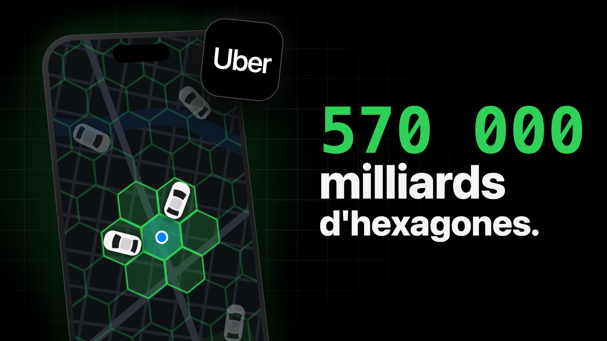
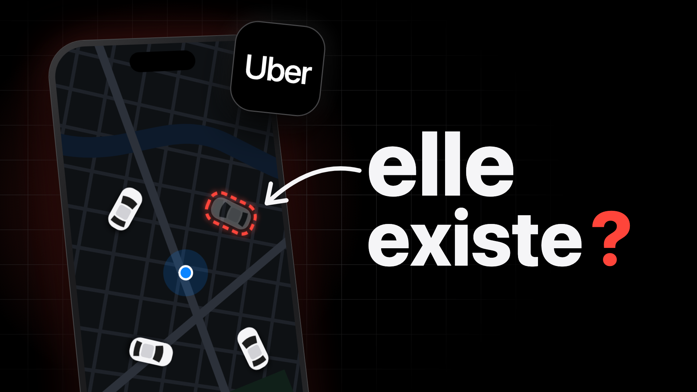
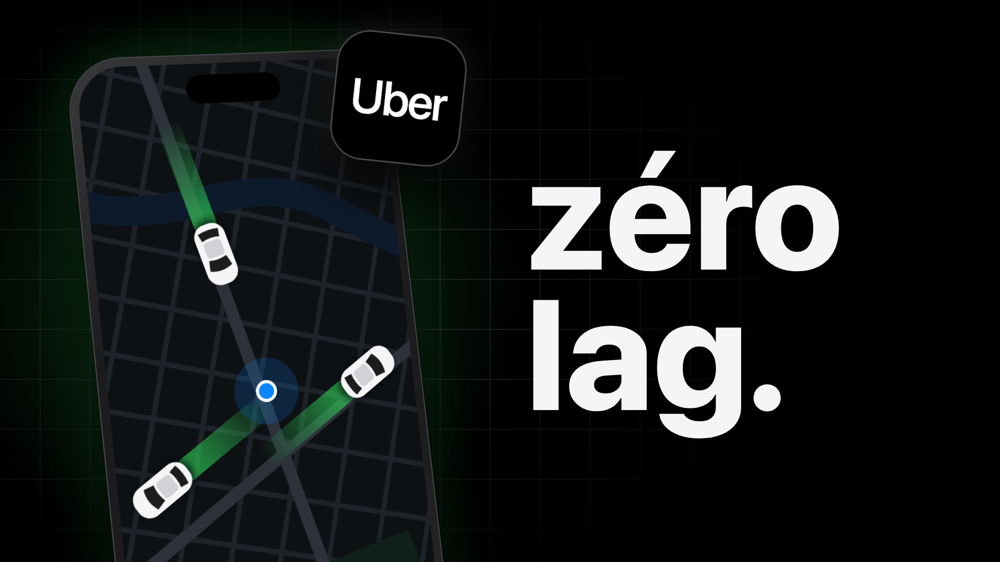

# Miniature Uber : 3 propositions

> Maquettes 1920×1080 dans [`propositions/`](propositions/) : [`a.png`](propositions/a.png), [`b.png`](propositions/b.png), [`c.png`](propositions/c.png). Le test de lisibilité aux tailles réelles est dans [`planche-mobile.png`](propositions/planche-mobile.png) (360 px et 168 px, sur le fond du mode sombre de YouTube).
> Source : [`propositions/miniature.html`](propositions/miniature.html). Pour refaire un PNG après une retouche :
> `"/Applications/Google Chrome.app/Contents/MacOS/Google Chrome" --headless=new --hide-scrollbars --window-size=1920,1080 --screenshot="$PWD/b.png" "file://$PWD/miniature.html?v=b"`

## Titre et miniature : qui dit quoi

- **Titre** : *Le génie caché derrière la carte en temps réel d'Uber* (53 caractères).
- **Ce que dit le titre** : il s'agit d'Uber et de sa carte en direct, et il y a de l'ingénierie cachée derrière.
- **Ce que la miniature doit ajouter** : *quoi*, concrètement, est surprenant. Ce sera les hexagones, une voiture qui n'existe peut-être pas, ou la fluidité.
- **⚠️ Sur mobile, le titre est coupé vers 45 caractères**, soit juste avant « Uber ». Le logo Uber dans la miniature est donc obligatoire, et il est présent dans les trois propositions. Une autre solution est de mettre Uber en tête du titre : *Uber : le génie caché derrière sa carte en temps réel* (53 caractères).

**La concurrence en français** : une recherche « comment fonctionne uber » (vidIQ, France) ne renvoie que des tutos pour commander une course, des vidéos de chauffeurs VTC et l'histoire business de Jared (185 K vues, juillet 2026). Aucune vidéo ne traite de l'ingénierie. Leurs miniatures sont claires ou colorées, donc une miniature noire et soignée se démarque dans la recherche.

## La base commune aux trois propositions

Seul **l'angle** change : le texte et ce qui se passe sur la carte. Le reste ne bouge pas, pour que le test de YouTube compare des promesses et pas des mises en page.

- **Fond** : noir `#000` avec la grille carrée de la vidéo (traits `#3a3a3c`), qui s'efface vers la droite. Un halo de la couleur d'accent se trouve derrière le téléphone.
- **Téléphone** :
  - à gauche, sur 40 % de la largeur, coupé en bas ;
  - incliné en 3D (environ 16° sur le côté, -5° de rotation) ;
  - carte sombre avec une Seine, deux avenues et ton point bleu au centre.
- **Icône Uber** : 250 px, elle chevauche le coin du téléphone, comme chez Philipp Lackner. C'est le repère qui remplace la fin du titre coupée sur mobile.
- **Texte** :
  - à droite, à partir de 52 % de la largeur ;
  - en SF Pro Heavy, en minuscules avec un point, comme « c'est enfin arrivé. » sur la miniature d'ArtCraft ;
  - 3 mots au maximum ;
  - deux couleurs d'accent au maximum : vert `#30d158` et rouge `#ff453a`, avec le blanc `#f5f5f7`.
- **Lien avec la vidéo** : la miniature se prolonge dans la vidéo. Le plan #1 (ANI-01) montre le même téléphone sur la même carte avec ses voitures blanches. Quand l'aperçu se lance tout seul sur l'accueil, le spectateur voit donc la suite directe de la miniature.

## A · « 570 000 milliards d'hexagones. »

- **Angle** : la prouesse. C'est le « chiffre qui semble impossible » de la stratégie.
- **Sur la carte** :
  - les hexagones verts recouvrent la ville ;
  - la case de ton point est pleine, et ses 6 voisines sont en vert clair ;
  - deux voitures blanches sont dans les cases voisines ;
  - les autres voitures sont éteintes à 30 %, parce que ce sont celles qu'Uber ne regarde pas.
- **Texte** :
  - « 570 000 » en SF Mono vert, 200 px ;
  - « milliards » en blanc, 150 px ;
  - « d'hexagones. » en blanc, 112 px.
- **Lien avec la vidéo** : le hook de 0:03.5, « Uber a découpé la planète en hexagones », et le compteur 569 707 381 193 162 du plan #2.
- **Pour qui** : les curieux de tech et les devs, l'ancien public Flutter/Kotlin.
- **Risque** : sans « d'hexagones », on peut lire « 570 000 milliards » comme une somme d'argent, et ce serait trompeur. Ne descends jamais ce mot sous 110 px.

## B · « elle existe ? » ⭐ ma recommandation

- **Angle** : le mystère.
- **Sur la carte** :
  - trois voitures blanches normales ;
  - une quatrième, juste à côté de ton point, est transparente à 28 % et entourée d'un pointillé rouge lumineux ;
  - une flèche blanche dessinée à la main part du texte et pointe vers elle.
- **Texte** : « elle » à 250 px et « existe » à 212 px en blanc, avec un **?** rouge.
- **Lien avec la vidéo** : c'est la question posée à 0:25 (« est-ce que toutes ces voitures existent vraiment ? »), et la réponse arrive à 7:48, avec les voitures fantômes. Le spectateur qui clique pour cette question reste donc jusqu'à 81 % de la vidéo.
- **Pourquoi c'est ma recommandation** :
  - c'est la plus forte curiosité des trois ;
  - personne d'autre ne la pose en français ;
  - elle crée une tension avec le titre : un « génie »… ou des voitures fantômes ?
- **Honnêteté** : la vidéo traite vraiment le sujet (Motherboard 2015, le démenti d'Uber, l'explication par le décalage). Le texte pose une question et n'affirme rien, ce qui reste loin du piège à clics que YouTube pénalise.
- **Version finale (20/10)** : la voiture fantôme est agrandie de 30 %, elle se lit à 168 px. Le fichier à calques est [`photocraft/uber-b.psd`](photocraft/uber-b.psd) : décor (`propositions/miniature.html?v=b&layer=decor`), flèche vectorielle, « elle », « existe » et « ? » en calques de texte éditables (SF Pro 800, ombre portée, lueur rouge sur le « ? »). Export : [`photocraft/uber-b.png`](photocraft/uber-b.png).
  Pour réexporter après une retouche dans PhotoCraft : `photocraft-cli convert photocraft/uber-b.psd photocraft/uber-b.png`

## C · « zéro lag. »

- **Angle** : la fluidité. C'est la mise en page de Lackner (×35,7 sur sa chaîne), passée en noir.
- **Sur la carte** : trois voitures blanches qui glissent sur les avenues, chacune avec une traînée verte dégradée derrière elle.
- **Texte** : « zéro » et « lag. » en blanc, 300 px.
- **Pour qui** : le public gamer. Les 18-24 ans font 61 % de ta chaîne, et « lag » est un mot qu'ils emploient tous les jours.
- **Point fort** : c'est la plus lisible à 168 px.
- **Points faibles** :
  - « zéro lag » répète en partie « temps réel », qui est déjà dans le titre ;
  - la vidéo montre justement que la carte *a* du retard, et qu'elle le cache en faisant glisser les voitures. Si ça te gêne, écris « zéro lag ? ».

## À ne pas mettre

- **« COMMENT ?! »** (l'idée de la fiche) : le mot ne dit rien de plus que le titre.
- **Le jargon** : « H3 », « k-ring », « RAMEN ». Le spectateur ne les connaît pas avant de cliquer.
- **Une vraie capture de l'appli Uber, ou un visage** : la carte est recréée, et la chaîne est faceless. L'icône suffit pour reconnaître Uber.
- **« 570 milliards »** : c'est le chiffre faux de la prise de voix. Le bon chiffre est 570 000 milliards.
- **Plus de deux couleurs d'accent, ou des noms de rues** : ces détails deviennent du bruit à 168 px.

## Lisibilité à la taille du mobile

Sur la [planche](propositions/planche-mobile.png), à 168 px :
- **Ce qui reste lisible** : le texte des trois, l'icône Uber, le point bleu, le nid d'hexagones (A) et les traînées (C).
- **Ce qui disparaît** : la voiture fantôme de B (à agrandir), « d'hexagones. » sur A (lisible de justesse), et les petites rues (sans importance).
- **Sur le fond `#0f0f0f` du mode sombre**, le bord noir de la miniature se fond dans la page. Le halo coloré et le texte blanc doivent donc porter seuls le contraste. Garde le halo.

## Test A/B

Mets **les trois** dans *Tester et comparer* de YouTube Studio : YouTube accepte jusqu'à 3 miniatures.
- **Réglage** : sur ordinateur uniquement.
- **Durée** : jusqu'à 2 semaines.
- **Critère du gagnant** : la part de durée de visionnage, pas le taux de clic (CTR). Une miniature qui fait cliquer sans faire regarder ne gagne pas.
- **Ce qu'on apprend** : quel angle marche le mieux pour la série « Le génie derrière l'app » (prouesse, mystère ou fluidité). WhatsApp et Waze en profiteront.
- **Dans la vidéo** : si B gagne, la question « elle existe ? » est déjà posée à 0:25, donc rien à changer.

## Titre + miniature : vérification (B)

| Règle | Statut | Détail |
|---|---|---|
| Rien n'est dit deux fois | ✅ | Le titre parle de génie, de carte et de temps réel ; la miniature montre une voiture qui n'existe peut-être pas |
| Les émotions vont ensemble | ✅ | L'admiration du titre et le doute de la miniature créent une tension qui donne envie de trancher |
| La curiosité monte | ✅ | « Un génie… qui affiche des fausses voitures ? » : les deux ensemble posent une question que ni l'un ni l'autre ne pose seul |
| Aucun mot du titre dans la miniature | ✅ | Aucun mot en commun |
| Lisible sur mobile | ⚠️ | Le titre perd « Uber » sur mobile, et l'icône compense. La voiture fantôme est à agrandir |

**Verdict** : bonne synergie, à condition d'agrandir la voiture fantôme.

## Repères de CTR

| Indicateur | Valeur | Source |
|---|---|---|
| CTR moyen, tech et tests | 7,5 % | `thumbnail-ctr-guide.md` (Focus Digital, déc. 2025) |
| CTR moyen, éducation | 4,5 % | idem |
| CTR sain quand la vidéo touche un public plus large | 4 à 8 % | idem |
| CTR selon la taille de la chaîne (1 000 à 10 000 abonnés) | Pas de repère dans le guide | — |

**Objectif** : la vidéo est entre l'éducation et la tech. Elle doit **tenir 5 % ou plus** une fois sortie du cercle de tes abonnés (après 48 h) ; **7,5 %** la placerait au niveau de la moyenne tech. Compare aussi avec le CTR d'ArtCraft dans Studio : c'est ton vrai point de comparaison.
